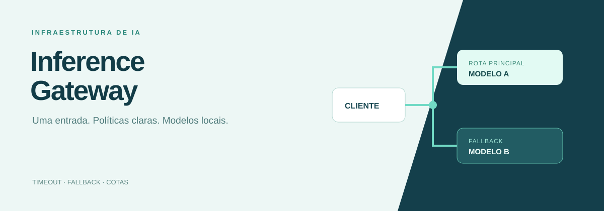
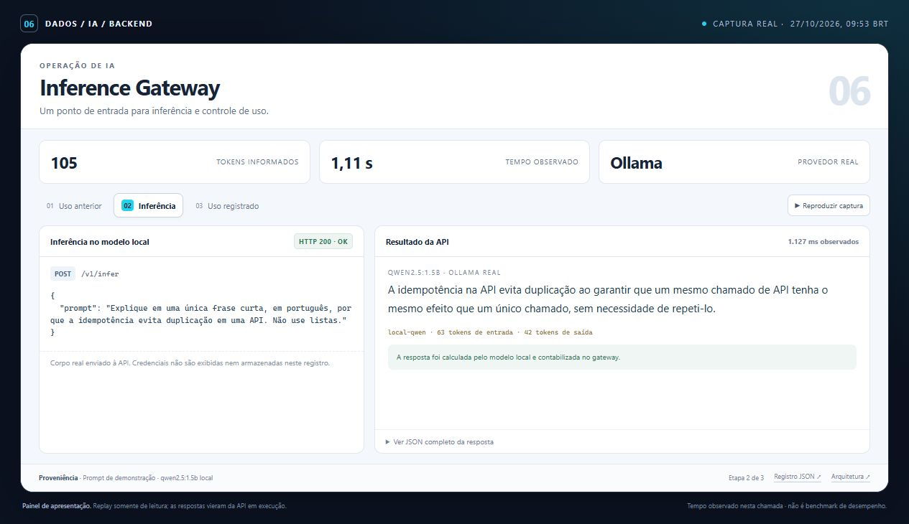
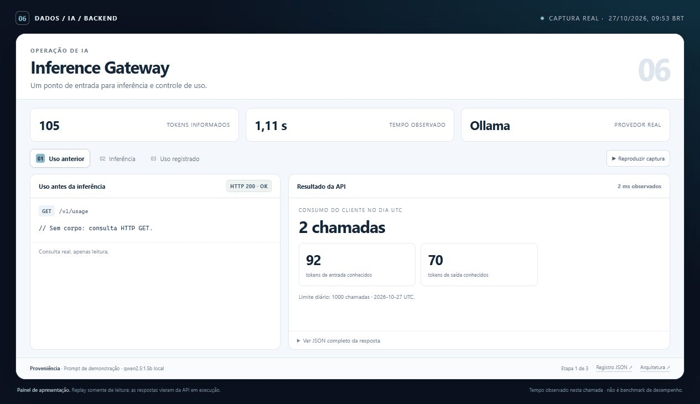
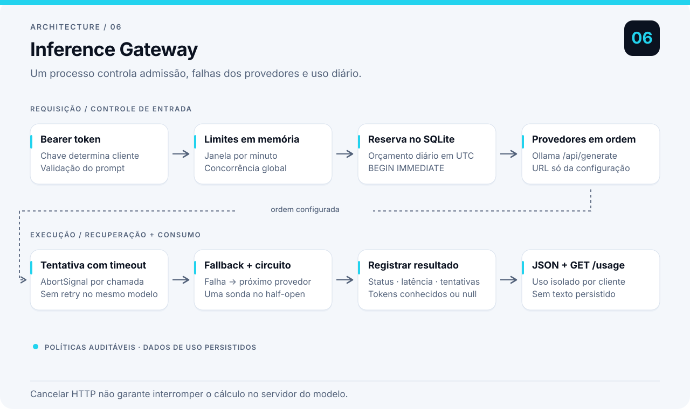

# Inference Gateway

Encaminha inferências para modelos e mantém políticas de falha e consumo por cliente. Timeouts, fallback, circuit breaker, concorrência e orçamento diário tornam o comportamento do backend observável e verificável.

**Competência principal:** Operação de sistemas de IA.

| IA implementada | Backend | Dados da demonstração | Verificação local |
| --- | --- | --- | --- |
| Adaptador Ollama com fallback | Node.js 24 · TypeScript · SQLite | Prompts fictícios · inferência local real | 11 testes aprovados |

[Demonstração e captura](docs/PRESENTATION.md) · [Resultado registrado](reports/ollama-integration.json) · [Plano de commits](COMMITS.txt)

## Demonstração

Painel de demonstração com respostas reais da API. A apresentação organiza requisições, resultados e verificações da execução registrada.

| Captura no navegador | Demonstração animada |
| :---: | :---: |
|  |  |

[Abrir painel local em HTML](docs/demo/index.html) · [Consultar requests, respostas e timestamps](docs/demo/run.json)

Os dados e os limites do cenário estão descritos no [guia da demonstração](docs/PRESENTATION.md). O painel foi preparado para apresentar o backend e suas evidências.

## Arquitetura



Autenticação por cliente, políticas por tentativa, roteamento entre provedores e contabilização transacional. Veja as [decisões técnicas](docs/architecture.md).

## Rodar

Requer Node.js 24+. Nao ha dependencia de runtime alem do Node. O SQLite embutido pode emitir aviso experimental.

```powershell
npm ci
Copy-Item .env.example .env
npm run typecheck
npm test
npm run demo
npm start
```

`npm run demo` injeta uma falha no primeiro provedor e mostra o fallback, o circuito aberto e a contabilizacao. Nao depende de `.env` ou de um modelo baixado.

```powershell
$headers = @{Authorization='Bearer demo-client-a'}
$body = @{prompt='Explique validacao temporal em duas frases.'} | ConvertTo-Json
Invoke-RestMethod http://127.0.0.1:8006/v1/infer -Method Post -Headers $headers -ContentType 'application/json' -Body $body
Invoke-RestMethod http://127.0.0.1:8006/v1/usage -Headers $headers
Invoke-RestMethod http://127.0.0.1:8006/health
```

Cada chave esta vinculada a um cliente. Campos de cliente enviados no corpo nao alteram essa identidade. `/v1/usage` consulta apenas o consumo daquele cliente no dia UTC atual. O banco fica em `var/usage.sqlite`; prompts e respostas nao sao gravados nele.

Os totais de tokens somam somente valores informados pelo provedor final bem-sucedido. `requestsWithInputTokens` e `requestsWithOutputTokens` mostram quantas chamadas contribuiram para cada soma; se nenhuma informou o valor, a soma e `null`. Tentativas anteriores que falharam podem ter consumido tokens nao contabilizados. Esses campos nao sao uma fatura completa dos provedores.

## Modelos reais

Instale o Ollama separadamente e obtenha os modelos que pretende usar. Configure `.env`, por exemplo:

```text
PROVIDERS_JSON=[{"id":"primary","kind":"ollama","baseUrl":"http://127.0.0.1:11434","model":"SEU_MODELO_PRINCIPAL"},{"id":"backup","kind":"ollama","baseUrl":"http://127.0.0.1:11434","model":"SEU_MODELO_RESERVA"}]
PROVIDER_TIMEOUT_MS=30000
```

Os nomes sao placeholders: substitua por modelos que voce baixou. A ordem define a prioridade. Dois modelos no mesmo servidor compartilham o risco de indisponibilidade; servidores separados permitem testar falhas independentes. O gateway usa `/api/generate`, com `stream=false` e saida limitada a 512 tokens pelo pedido ao provedor. Tokens de entrada e saida vem da resposta do Ollama; quando ausentes, ficam `null`. Nao ha estimativa ficticia de custo financeiro.

## Politicas

- Timeout por tentativa; aborta a requisicao HTTP e tenta o proximo provedor.
- Circuito abre apos o numero configurado de falhas consecutivas; depois do cooldown, uma unica chamada faz o teste de recuperacao.
- O limite por minuto e por cliente, em memoria. A janela inicia na primeira chamada.
- O orcamento diario conta requisicoes aceitas, inclusive falhas. A reserva e transacional e persistente. Reiniciar nao zera esse contador.
- Concorrencia acima do limite devolve 503 e `Retry-After`. Nao existe fila oculta.
- A resposta contem requestId, provedor usado, tentativas, fallback, latencia e tokens informados pelo modelo.

O pior tempo nominal de uma requisicao e o numero de provedores multiplicado pelo timeout individual. Sao aceitos no maximo quatro provedores. O cliente deve usar timeout compativel. Uma chamada abortada pode continuar consumindo recursos no servidor do modelo: cancelar HTTP nao garante cancelar inferencia interna.

## Verificacao e limites

Os testes cobrem falha, timeout, fallback, circuito half-open, limite de concorrencia, persistencia do orcamento, autenticacao, isolamento de consumo e protocolo HTTP do Ollama com um servidor local controlado. Eles nao avaliam qualidade de respostas de modelos reais.

`npm run verify:ollama` executa uma verificacao complementar com Ollama real: inferencia pela API em execucao, contabilizacao de tokens e failover HTTP de um primario inacessivel para um backup real. O [procedimento de integracao](docs/ollama-integration.md) explica modelos, configuracao e o que o relatorio comprova.

O [relatorio versionado](reports/ollama-integration.json) registra o teste aprovado com Qwen2.5 1.5B: resposta do gateway em container, tokens reais e duas chamadas da instancia de failover, com o primario pulado na segunda chamada porque o circuito estava aberto. A suite isolada tem 11 testes aprovados e a verificacao de tipos passou.

Este servico e pensado para um unico processo. Rate limit e circuitos sao locais a esse processo; para multiplas replicas, esses estados precisariam de armazenamento compartilhado. Se o processo cair durante uma chamada, a reserva fica `running` e continua contando no orcamento. O endpoint de uso deixa esse estado visivel, mas nao ha reconciliacao automatica. Nao ha streaming, cache de texto, fila ou interface grafica.

As chaves do exemplo sao publicas e apenas para uso local. A URL do provedor vem da configuracao do operador, nunca do corpo enviado pelo cliente.

## Docker

```powershell
docker build -t inference-gateway .
docker run --rm -p 127.0.0.1:8006:8006 --env-file .env -e HOST=0.0.0.0 -v gateway-data:/app/var inference-gateway
```

Se Ollama estiver no host, ajuste `baseUrl` para um endereco acessivel pelo container.

Veja [docs/architecture.md](docs/architecture.md) e [COMMITS.txt](COMMITS.txt).
