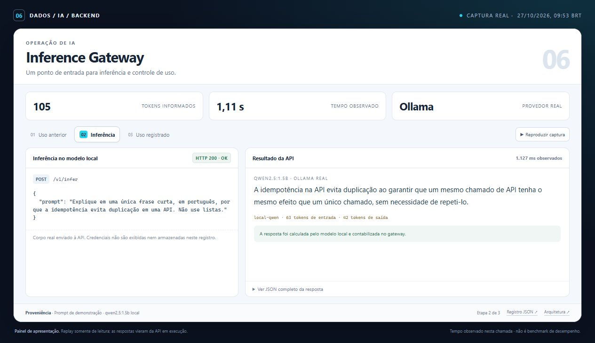

# Demonstração — Inference Gateway

O painel de demonstração mostra o backend por meio de respostas reais da API, coletadas em uma execução local. O screenshot e a animação são capturas desse painel renderizado no navegador.



[Ver animação](assets/demo.gif) · [Abrir o painel local](demo/index.html) · [Inspecionar o registro bruto](demo/run.json) · [Voltar ao README](../README.md)

## O que observar

- A inferência identifica o provedor e informa os tokens devolvidos pelo modelo real.
- O uso diário é persistido e consultado apenas pelo cliente associado à chave.
- O relatório de integração registra primário inacessível, backup real e circuito aberto na chamada seguinte.

## Dados e evidências

As perguntas de demonstração são fictícias. O modo Ollama usa qwen2.5:1.5b real; o modo demo determinístico continua disponível e é identificado na própria saída. O cenário de failover registrado usa uma conexão HTTP realmente indisponível e um backup Ollama, com requisições isoladas e contagens reais de tokens.

Relatório técnico complementar: [resultado registrado](../reports/ollama-integration.json).

`demo/run.json` conserva requests, respostas HTTP, códigos de status, duração e verificações de cada etapa. A seção `supporting_evidence` identifica os relatórios offline associados, incluindo seus hashes. Valores de avaliações anteriores continuam identificados como relatórios registrados, separados das respostas HTTP da execução capturada.

## Registro da captura

| Informação | Origem |
| --- | --- |
| Início da execução, UTC | `2026-10-27T12:53:38.851143+00:00` |
| Fim da execução, UTC | `2026-10-27T12:53:39.982435+00:00` |
| Respostas e verificações | [demo/run.json](demo/run.json) |
| Painel com dados incorporados | [demo/index.html](demo/index.html) |
| Captura no navegador | [assets/screenshot.jpg](assets/screenshot.jpg) |
| Fluxo animado | [assets/demo.gif](assets/demo.gif) |

Os timestamps acima pertencem à coleta da API. A imagem e o GIF documentam a apresentação desses dados no navegador. Abrir o HTML preserva o registro capturado; novas chamadas à API exigem o ambiente em execução.

## Reproduzir

Siga o setup no [README](../README.md) e execute, na raiz deste projeto:

```powershell
npm run demo
# Com Ollama e a API configurados para provedores reais:
npm run verify:ollama
```

A API usa a porta `8006`. Os exemplos HTTP e as configurações de ambiente estão no README. O painel local pode ser aberto pelo arquivo `docs/demo/index.html`, que incorpora os dados capturados e permite percorrer as etapas sem consultar os serviços.

O screenshot facilita a leitura inicial; o JSON, os testes e os comandos permitem verificar o comportamento apresentado. Uma execução capturada documenta aquele cenário e ambiente, com os limites de dados descritos neste projeto.
